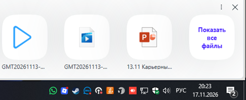
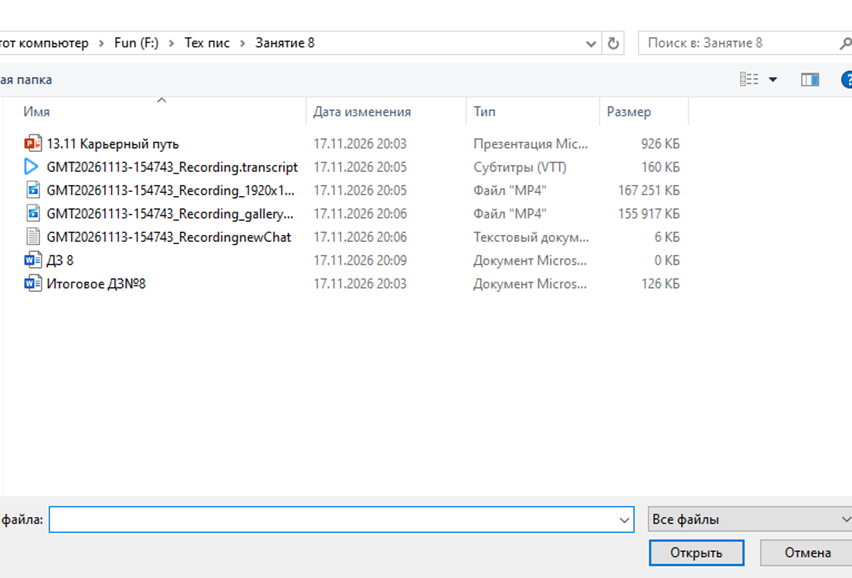
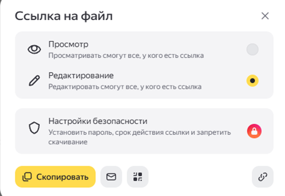
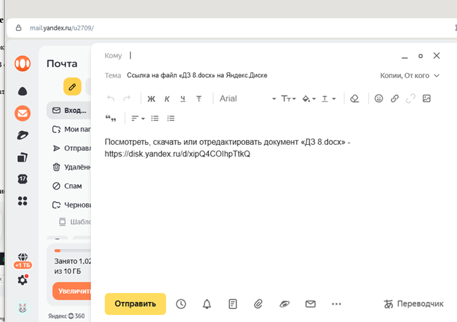

# **Инструкция-описание по созданию документов и настройки совместного доступа на Яндекс Диске**

1. Создать текстовый документ на Яндекс диске. Для этого на левой панели нажать значок **«Диск»**.

  

В открывшемся окне в верхней правой части нажать кнопку **«Загрузить»** *(рисунок 1)*.

2. Затем нажать **«Показать все файлы»** и выбрать документ из списка *(рисунок 2)*.

  

  <b>Рисунок 1 – Пример загрузки документа</b>

  

  

  <b>Рисунок 2 – Выбор документа для загрузки</b>

3. Открыть доступ по ссылке. Нажать на выбранный загруженный документ и выбрать вариант «Редактирование», а затем нажать на кнопку **«Скопировать»** *(рисунок 3)*. После того, как ссылка скопирована, нажать на значок конвертика  и поделиться ссылкой с возможностью редактирования с соавтором *(рисунок 4)*. В открывшемся окне ввести адрес электронной почты и нажать кнопку **«Отправить»**.

  

  <b>Рисунок 3 – Выбор работы с документом</b>

  

  <b>Рисунок 4 – Отправка ссылки</b>

4. Проверить, что соавтор видит файл. Попросить соавтора перейти по ссылке. Если файл открывается и доступен для редактирования, значит, доступ настроен корректно.
