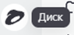
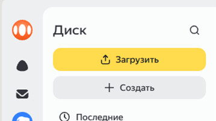

# **Инструкция-описание по созданию документов и настройки совместного доступа на Яндекс Диске**

1. Создать текстовый документ на Яндекс диске. Для этого на левой панели нажать значок **«диск»**.

В открывшемся окне в верхней правой части нажать кнопку **«Загрузить»** *(рисунок 1).

2. Затем нажать **«Показать все файлы»** и выбрать документ из списка (рисунок 2).
   

Рисунок 1 – Пример загрузки документа

Рисунок 2 – Выбор документа для загрузки

3. Открыть доступ по ссылке. Нажать на выбранный загруженный документ и выбрать вариант «Редактирование», а затем нажать на копку **«Скопировать»** (рисунок 3). После того, как ссылка скопирована, нажать на значок конвертика
   

 
 и поделиться ссылкой с возможностью редактирования с соавтором (рисунок 4).В открывшемся окне ввести адрес электронной почты и нажать кнопку **«Отправить»**.

 

 

 

Рисунок 3 – Выбор работы с документом

 

Рисунок 4 – Отправка ссылки

4. Проверить что соавтор видит файл. Попросить соавтора перейти по ссылке. Если файл открывается и доступен для редактирования, значит, доступ настроен корректно.
